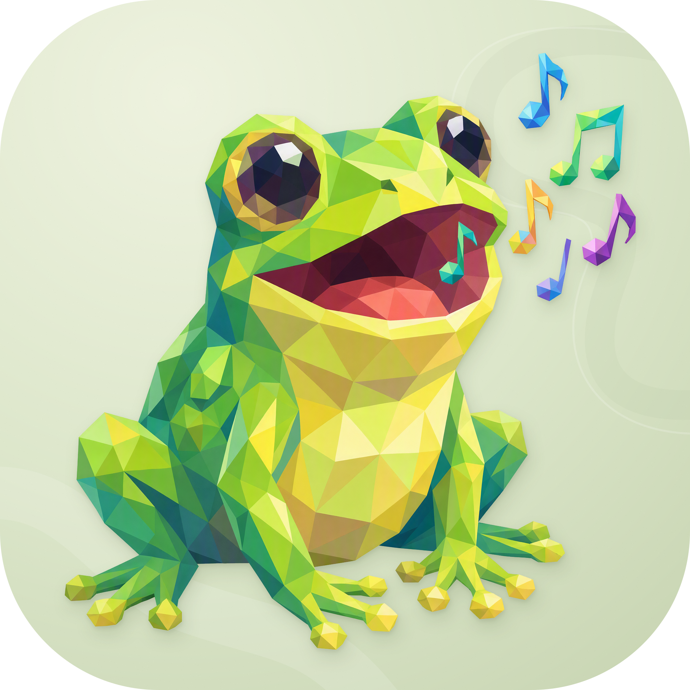

<p align="center">
  
</p>

<h1 align="center">Frogie</h1>

<p align="center">在本机集中设计、运行和观察各项目的 Agent。</p>

<p align="center">
  <a href="docs/README.md">文档</a>
</p>

<p align="center">
  <a href="https://github.com/earendil-works/pi/tree/main/packages/durable"></a>
  
</p>

## 这是什么

Frogie 是基于 [Pi Durable](https://github.com/earendil-works/pi/tree/main/packages/durable) 的个人多 Agent 管理平台，目标是通过一个常驻本机 daemon 和 Dashboard，统一管理各项目的定义、执行、聊天、历史与恢复。

随着接入项目增多，每个项目都可能形成自己的术语、角色配置、会话管理和恢复逻辑。Frogie 希望统一这些基础机制，让用户能从一个入口理解和维护各项目的 Agent，同时保留不同业务各自的工作方式。

用户在私有仓库与本地设计台中整理角色、提示词、技能、脚本和工作流。daemon 为各项目托管独立 Harness；业务项目通过公开通信 SDK 接入，保留自己的 UI、认证、上下文、业务工具和最终成果。

## 目标能力

- **跨项目的统一视图**：用同一套概念理解各项目的角色、职责、协作关系、模型选择和工具权限。
- **可移植的定义**：以结构化 Markdown 文件组织提示词、技能和工作流，配套脚本保留为源文件。
- **两种执行指导模式**：允许 Agent 自由安排工作，也可以提供包含输入、输出和交接要求的流程说明，由 Agent 自行理解和执行。
- **本地统一运行**：daemon 管理多个项目的 Harness、SQLite、模型、权限与恢复，沿用 Pi Durable 的原生语义。
- **完整观察与调试**：从全局工作概览进入主控、子会话、任务、工具、产物和压缩历史，直接与角色聊天并调试技能。
- **可选远端连接**：Frogie 主动建立认证 WSS，SDK 提供双向上下文、执行观察和业务结果交付。
- **本地沙箱执行**：利用本机文件、工具和算力，通过权限与隔离机制约束执行。

## 项目边界

| 事项 | 归属 |
| --- | --- |
| 私有定义、Prompt、Skills、脚本与版本 | Frogie 仓库及本地定义工作区 |
| Pi 执行、会话、SQLite、模型、恢复与本地产物 | Frogie daemon |
| 协议、认证、查询订阅与 Gateway 适配 | 公开通信 SDK |
| 业务 UI、用户授权、上下文、审批与最终作品 | 使用方项目 |
| 请求投递与业务操作回执 | 两端各自持久保存，按协议对账 |

实际权限由角色定义、本机授权及本次业务授权共同限定。执行脚本由本机 OS 沙箱约束，业务写入与审批由项目控制器检查。

模型可以来自远程服务，也可以来自兼容的本地服务。关闭 Dashboard 保留 daemon 执行；未连接业务远端时，本地仍可聊天、读取历史、总结与调试。业务项目仍提供自己的基本功能，远端上下文读取和结构化结果写回按连接能力呈现。

## 本地体验

以下命令对应当前实现。daemon 已提供项目登记、独立 Harness 启停、快照绑定及多项目 Dashboard；完整工具、工作流调试和公开 SDK 按 [MVP 实施](docs/08-mvp-implementation.md) 继续交付，设计能力以对应验收结果为准。

运行 `pnpm dev` 构建并启动 Local，直接打开 `https://frogie.dev.hexly.ai`。本机 Caddy 将该域名转发到 `127.0.0.1:7033`。

Local 使用真实的 OpenAI-compatible Chat Completions 模型。服务端从 `data/local-model.json` 读取私有配置，也可通过 `FROGIE_MODEL_CONFIG` 指定文件；密钥仅留在服务端。配置格式如下，将示例值替换为自己的模型配置：

```json
{
  "baseUrl": "http://127.0.0.1:3425/v1",
  "apiKey": "your-api-key",
  "modelId": "your-model-id",
  "contextWindow": 128000,
  "maxTokens": 4096,
  "thinkingLevel": "low"
}
```

模型地址接受 HTTPS 或 loopback HTTP。Local 在 `data/local/daemon/` 保存项目登记与运行数据，每个项目的 Harness 拥有独立的冻结定义、运行身份与会话 SQLite。重启使用原绑定，定义编辑后可以显式绑定新快照并保留旧历史；旧版 `data/local/dashboard/` 保持原样。已运行的 Harness 可在“对话”页面选择角色并发送消息，费用按模型服务计费。缺少已声明工具或扩展的项目显示装配错误，定义仍可查看和编辑。

`FROGIE_MODE=e2e pnpm dev` 启动 Pi 官方确定性模型替身，每次在 `data/e2e/` 创建独立目录，不读取 Local 模型配置。当前入口由启动参数固定环境，右上角分段控件显示实际环境。完整 Workflow 画布、真实多角色派发与界面跨环境切换继续按设计文档实现。

## 项目接入

目标接入采用公开 npm 通信 SDK，业务项目安装客户端与 Gateway 适配，本机 Frogie 主动连接。SDK 提供聊天、历史、任务和工具进展，以及上下文和业务回执；私有定义和 Pi 执行保留在本机。

当前 his.fm 使用 `@frogie/core/host` 的嵌入式接入，相关角色保存在 `squads/hisfm/`。切换顺序是本地多 Squad 闭环、SDK 验证与发布、his.fm 完整生产、其他业务接入。职责和切换边界见 [项目集成](docs/09-project-integration.md)，协议见 [通信 SDK](docs/11-communication-sdk.md)。

## 文档

本项目文档统一使用中文，完整目录见 [文档索引](docs/README.md)。设计文档按编号持续补充，索引随文档更新。

## 许可证

[MIT](LICENSE)
